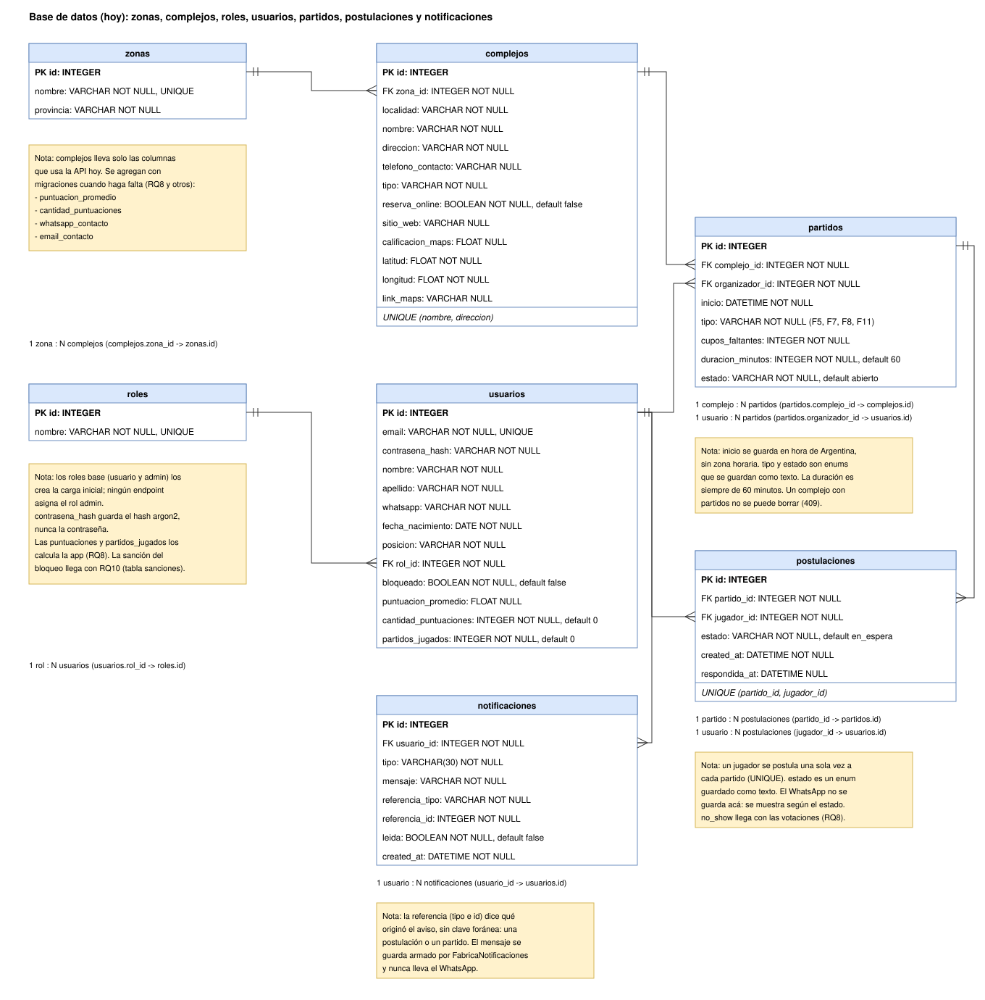

# Base de datos — Fulvo (MVP)

Documento de trabajo del esquema de la base de datos. Igual que [`clases.md`](clases.md), se arma de a poco y cada decisión queda anotada acá.

**Alcance de hoy: `zonas`, `complejos`, `roles` y `usuarios`**, que son las entidades que ya tienen endpoints (RQ1, RQ3 y RQ10). El resto de las clases de [`clases.md`](clases.md) (`Partido`, `Postulacion`, `Sancion`, etc.) todavía no tiene tabla: se agregan una por una, con una migración de Alembic cada vez, a medida que se hagan sus endpoints.

Diagrama: [`diagramas/base-de-datos.drawio`](diagramas/base-de-datos.drawio) (editable en draw.io) y [`diagramas/base-de-datos.svg`](diagramas/base-de-datos.svg).



## 1. Cómo se relaciona con el resto del código

La tabla se declara con un **modelo** SQLAlchemy (`fulvo/models.py`). El modelo es la clase de dominio y la tabla a la vez (`mapped_as_dataclass`). No reemplaza a los schemas Pydantic de `fulvo/schemas.py`: el modelo describe lo que se guarda y el schema describe lo que entra y sale por HTTP.

```
JSON -> ZonaEntrada / ComplejoEntrada (valida) -> modelo Zona / Complejo (BD) -> ZonaPublica / ComplejoPublico (JSON)
JSON -> UsuarioEntrada (valida) -> modelo Usuario (BD, con contrasena_hash) -> UsuarioPublico (JSON, sin hash ni WhatsApp)
```

Los schemas de entrada y salida **no cambian**: la API sigue devolviendo lo mismo que hoy.

## 2. Tablas

Los nombres de tablas y columnas van en español, en plural las tablas y sin tildes, como indica `CLAUDE.md`.

### `zonas`

| Columna | Tipo | Restricciones |
|---|---|---|
| `id` | entero | clave primaria |
| `nombre` | texto | obligatorio, único |
| `provincia` | texto | obligatorio |

Una zona es un partido o un barrio (Vicente López, Belgrano). Ver `clases.md`.

### `complejos`

| Columna | Tipo | Restricciones |
|---|---|---|
| `id` | entero | clave primaria |
| `zona_id` | entero | obligatorio, clave foránea a `zonas.id` |
| `localidad` | texto | obligatorio |
| `nombre` | texto | obligatorio |
| `direccion` | texto | obligatorio |
| `telefono_contacto` | texto | opcional |
| `tipo` | texto | obligatorio |
| `reserva_online` | booleano | obligatorio, por defecto falso |
| `sitio_web` | texto | opcional |
| `calificacion_maps` | decimal | opcional |
| `latitud` | decimal | obligatorio |
| `longitud` | decimal | obligatorio |
| `link_maps` | texto | opcional |

Restricción de tabla: `UNIQUE (nombre, direccion)`.

### `roles`

| Columna | Tipo | Restricciones |
|---|---|---|
| `id` | entero | clave primaria |
| `nombre` | texto | obligatorio, único |

Roles base: `usuario` y `admin`. Los crea la carga inicial; ningún endpoint crea roles ni asigna `admin`.

### `usuarios`

| Columna | Tipo | Restricciones |
|---|---|---|
| `id` | entero | clave primaria |
| `email` | texto | obligatorio, único (se guarda en minúsculas) |
| `contrasena_hash` | texto | obligatorio (hash argon2, nunca la contraseña) |
| `nombre` | texto | obligatorio |
| `apellido` | texto | obligatorio |
| `whatsapp` | texto | obligatorio |
| `fecha_nacimiento` | fecha | obligatorio |
| `posicion` | texto | obligatorio |
| `rol_id` | entero | obligatorio, clave foránea a `roles.id` |
| `bloqueado` | booleano | obligatorio, por defecto falso |
| `puntuacion_promedio` | decimal | opcional (vacío hasta el primer voto) |
| `cantidad_puntuaciones` | entero | obligatorio, por defecto 0 |
| `partidos_jugados` | entero | obligatorio, por defecto 0 |

Migración: `329a5a4ee4ad` (crear roles y usuarios), sobre `3cc091c1aa49` (zonas y complejos).

### Relaciones

- Una zona tiene muchos complejos y cada complejo pertenece a una sola zona (`complejos.zona_id` apunta a `zonas.id`).
- Un rol tiene muchos usuarios y cada usuario tiene un solo rol (`usuarios.rol_id` apunta a `roles.id`).

## 3. Decisiones

- **Solo las columnas que usa la API hoy.** Quedan afuera `puntuacion_promedio`, `cantidad_puntuaciones`, `whatsapp_contacto` y `email_contacto`, que `clases.md` prevé para `Complejo`. Se agregan con una migración cuando llegue el RQ que las necesite (la puntuación llega con RQ8). Así cada columna tiene un endpoint que la justifica, y se practica la migración incremental.
- **Sin `created_at` ni `updated_at` por ahora.** Ningún RQ los pide para zonas y complejos. Se suman cuando haya una tabla que los necesite (por ejemplo `Notificacion` ya los define en `clases.md`).
- **La provincia vive solo en `zonas`.** El complejo no la guarda: la API la devuelve leyéndola de su zona. Así un complejo no puede contradecir a su zona. Es lo mismo que hace hoy `crear_complejo`, que copia la provincia de la zona.
- **`zona_id` es una clave foránea por id, no por nombre.** Hoy un complejo apunta a su zona por el nombre. Con la base de datos es una referencia al `id`, y el nombre se obtiene con la relación `Complejo.zona`.
- **Relación en un solo sentido.** El modelo `Complejo` tiene `zona` (muchos a uno). `Zona` no tiene `complejos`, porque ninguna ruta lo necesita. Si hace falta se agrega después sin tocar la tabla.
- **`tipo` es texto libre.** Los valores del CSV son pocos (Campo de fútbol, Cancha de fútbol sala, Club deportivo, etc.) y ninguna regla depende de ellos. No se arma una tabla ni un `Enum` hasta que haga falta filtrar o validar por tipo.
- **Coordenadas como decimal de punto flotante (`Float`).** Alcanza para ubicar un complejo en un mapa. La distancia se sigue calculando en Python con haversine (`distancia_km`), igual en SQLite y PostgreSQL.
- **Unicidad.**
  - `zonas.nombre` único y `complejos (nombre, direccion)` único. Reflejan las reglas de `409` que ya tiene la API.
  - La base distingue mayúsculas (`Belgrano` y `belgrano` son valores distintos para SQLite y PostgreSQL). Por eso las rutas siguen comparando sin mayúsculas antes de insertar, como hoy con `buscar_zona`. La restricción de la base es la última red de seguridad, no el chequeo principal.
- **Ids que no se reutilizan.** Al borrar el último complejo, uno nuevo no debe heredar su id: un cliente que guardó ese id vería otro recurso en lugar de un 404. En PostgreSQL la secuencia lo garantiza sola. SQLite sí reutiliza el id del último registro borrado, así que `Complejo` usa `sqlite_autoincrement=True` para comportarse igual. Eso reemplazó a la clase `Secuencia` de la versión con listas en memoria, que ya se borró.
- **Borrado.** `DELETE /complejos/{id}` borra la fila. Cuando exista `Partido` (que referencia a `Complejo`), hay que decidir qué pasa con los partidos de un complejo borrado (rechazar el borrado o marcarlo inactivo). Queda anotado y no se resuelve hoy. `zonas` no tiene endpoint de borrado.
- **Edición.** `PUT /zonas/{id}` y `PUT /complejos/{id}` reemplazan la fila completa con las mismas reglas del alta (zona existente, sin repetir nombre o nombre y dirección). El propio registro no cuenta como repetido de sí mismo. Como los complejos guardan `zona_id`, renombrar una zona o cambiarle la provincia se ve en todos sus complejos sin tocarlos.
- **Traducción modelo a schema.** `ComplejoPublico` expone `zona` como el nombre (texto) y `provincia`, pero el modelo guarda `zona_id`. La ruta arma el schema con una función chica (`complejo_publico`) que lee `complejo.zona.nombre` y `complejo.zona.provincia`. `ZonaPublica` se lee directo del modelo con `from_attributes=True`.

Usuarios y roles:

- **Roles en una tabla y no un booleano `es_admin`.** Así se pueden sumar roles sin tocar `usuarios` (`requerimientos.md`). Los permisos se validan en un solo punto, `Usuario.tiene_rol`, y la API los traduce a 403 en `exigir_admin` (`fulvo/security.py`).
- **El perfil de jugador vive en `usuarios`.** `clases.md` decide que `Usuario` absorbe el perfil (relación 1 a 1), así que `posicion` y las puntuaciones son columnas de la misma tabla y no hace falta una tabla `jugadores`.
- **Columnas calculadas.** `puntuacion_promedio`, `cantidad_puntuaciones` y `partidos_jugados` las actualiza la app con las votaciones (RQ8), no el usuario. Por eso no se reciben al registrarse.
- **Email único y en minúsculas.** Es el identificador del login. El registro y el login lo pasan a minúsculas, así que la restricción `UNIQUE` de la base alcanza para que `Ana@x.com` y `ana@x.com` sean la misma cuenta. Con `zonas.nombre` no se puede hacer lo mismo, porque el nombre se guarda tal como se escribió.
- **Solo el hash de la contraseña.** `contrasena_hash` guarda el hash argon2 (`pwdlib`), que lleva su propia sal. La contraseña en claro no se guarda ni se loguea.
- **Edad mínima en el modelo, no en la tabla.** Se guarda `fecha_nacimiento` y la regla de 16 años la aplica `Usuario.edad(hoy)` al registrar. Guardar la edad no sirve, porque cambia con el tiempo.
- **`bloqueado` es un booleano por ahora.** Alcanza para que un usuario bloqueado no pueda iniciar sesión. La sanción con motivo, admin y fechas (RQ10) llega con la tabla `sanciones`.
- **Sin `sqlite_autoincrement` en `roles` ni `usuarios`.** Ninguna de las dos tiene endpoint de borrado, así que un id no se puede reutilizar. Se agrega si llega una baja de usuarios, como en `complejos`.

## 4. Configuración y datos iniciales

- **Conexión.** `DATABASE_URL` en `.env`, leída con `pydantic-settings` (`fulvo/settings.py`). En desarrollo es un archivo SQLite (`sqlite:///fulvo.db`, ignorado por git con `*.db`). En contenedor, CI y producción es PostgreSQL con `postgresql+psycopg://...`.
- **Clave de los tokens.** `SECRET_KEY` también va en `.env` y es obligatoria. Sin ella no arranca nada que lea `Settings`, ni siquiera Alembic, que la usa para leer `DATABASE_URL`. Ver [`entorno.md`](entorno.md#7-crear-el-env), paso 7.
- **Esquema.** Lo crea Alembic (`alembic upgrade head`), nunca `create_all` fuera de los tests. Los tests sí usan `create_all` sobre SQLite en memoria, como `codigo_aulas/07`.
- **Carga inicial.** Script manual e idempotente: `python -m fulvo.carga_inicial` crea los roles base, lee `fulvo/datos/complejos.csv` e inserta las zonas y complejos que todavía no existen. Si `ADMIN_EMAIL` y `ADMIN_PASSWORD` están en el `.env`, también crea el primer admin; si ya hay un usuario con ese email, no lo toca. Se puede correr las veces que haga falta, y `entrypoint.sh` lo corre después de `alembic upgrade head` en el deploy. Las zonas se crean en el orden en que aparecen en el CSV, y los complejos en el orden de las filas, así que los ids quedan iguales a los de la lista en memoria de hoy.

## 5. Pendiente

- Tablas del resto de las clases (`Partido`, `Postulacion`, `Votacion`, `Notificacion`, `Reclamo`, `Sancion`), de a una con su migración. Este documento y el diagrama se amplían en cada paso.
- Datos de prueba: los tests de rutas cargan los roles y el CSV completo (8 zonas y 51 complejos) con la fixture `datos_iniciales`. Los usuarios de prueba se arman con `guardar_usuario` en `tests/conftest.py`; con el aula 09 pasan a `factory-boy`, como la cátedra.
