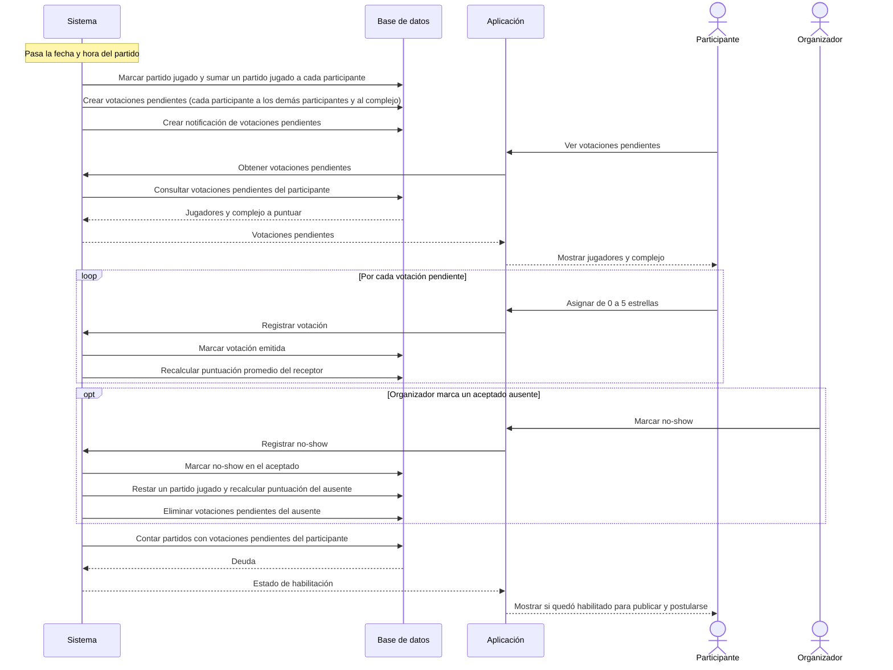

# Votación después del partido (RQ8)

Cambios contra el doc viejo: deuda cuenta por partido, solo el organizador marca no-show, sin cancha como entidad (se vota al complejo), sin ventana de votación.

